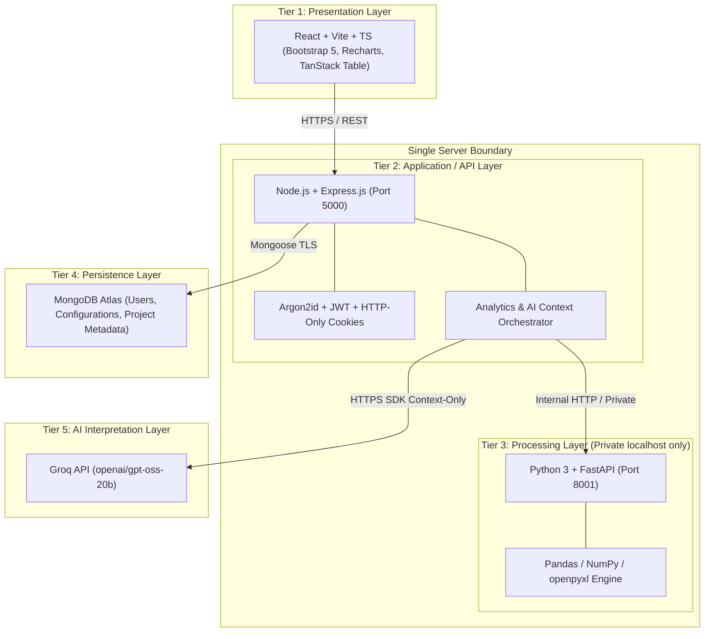

# BLYc System Architecture

## 1. Overview
BLYc is an automated business analytics calculator designed with a logical **N-tier architecture**, operating on a unified deployment model (single-server hostable or containerized).

---

## 2. Layer Responsibilities & Isolation

### Tier 1: Presentation Layer (React + Vite + TypeScript)
- Client-side data interaction, state management, and visualizations.
- Never directly contacts MongoDB, Python FastAPI, or Groq. All calls are routed through Tier 2.
- No secrets or API credentials reside in the frontend client.

### Tier 2: Application / API Layer (Node.js + Express)
- Serves as the central API gateway and security boundary.
- Enforces user authentication, authorization, session validation, and tenant/project data isolation.
- Manages dataset file uploads (validation, sanitization, passing to Python service).
- Token-budgeted context extraction for AI requests; sends only sanitized, verified statistical facts to Tier 5.

### Tier 3: Data Processing Layer (Python 3 + FastAPI)
- Bound strictly to internal loopback (`127.0.0.1:8001`), shielded from public internet exposure.
- Authoritative calculation engine for spreadsheet parsing, duplicate detection, category normalization, statistical profiling, and formula execution.
- Safe AST formula parsing prevents arbitrary code execution (`eval` and `exec` strictly prohibited).

### Tier 4: Persistence Layer (MongoDB Atlas)
- Stores user accounts, preferences, dashboard configurations, custom calculation metadata, and project manifests.
- Raw spreadsheet data is not permanently stored in MongoDB in MVP; data lives in portable JSON project manifests and user session storage.

### Tier 5: AI Interpretation Layer (Groq API)
- Fixed model: `openai/gpt-oss-20b`.
- Acts strictly as an interpretation and explanation assistant based on verified Python calculations. Never serves as the primary calculation source.
